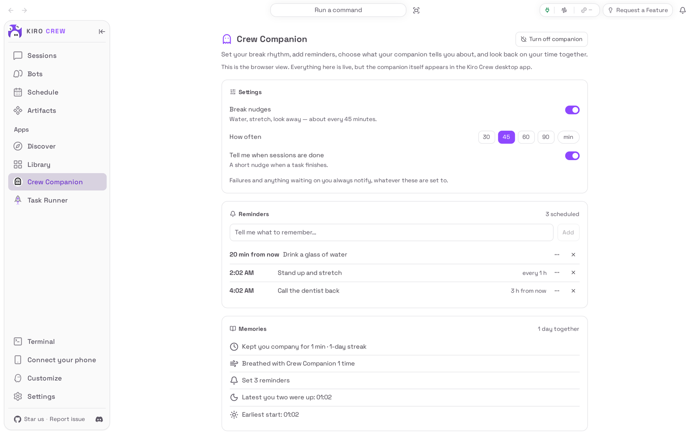
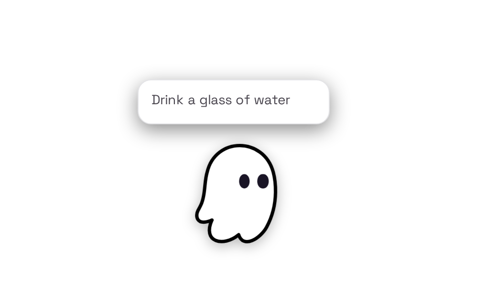
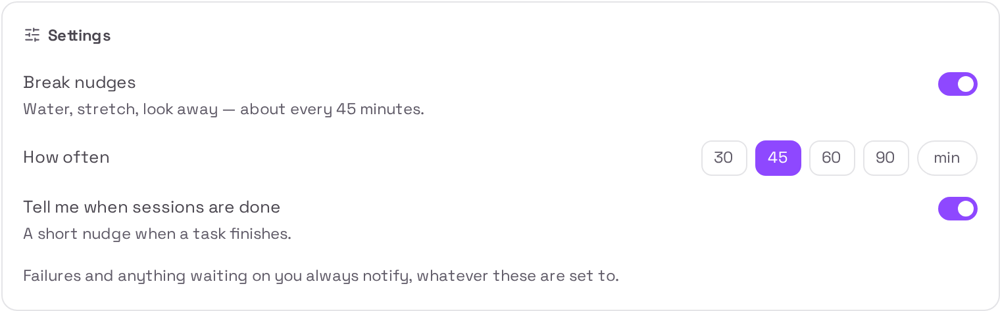
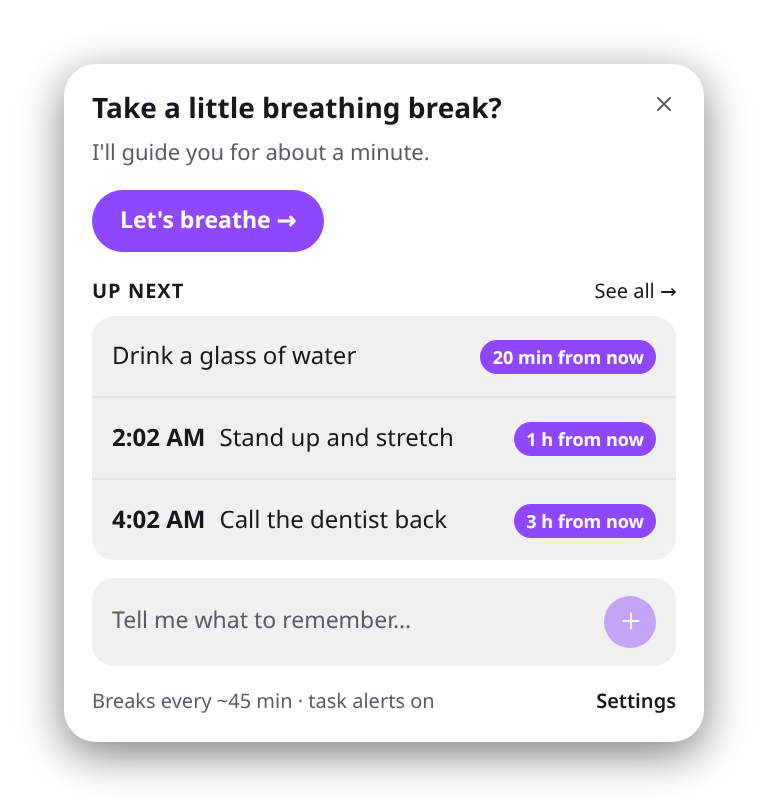
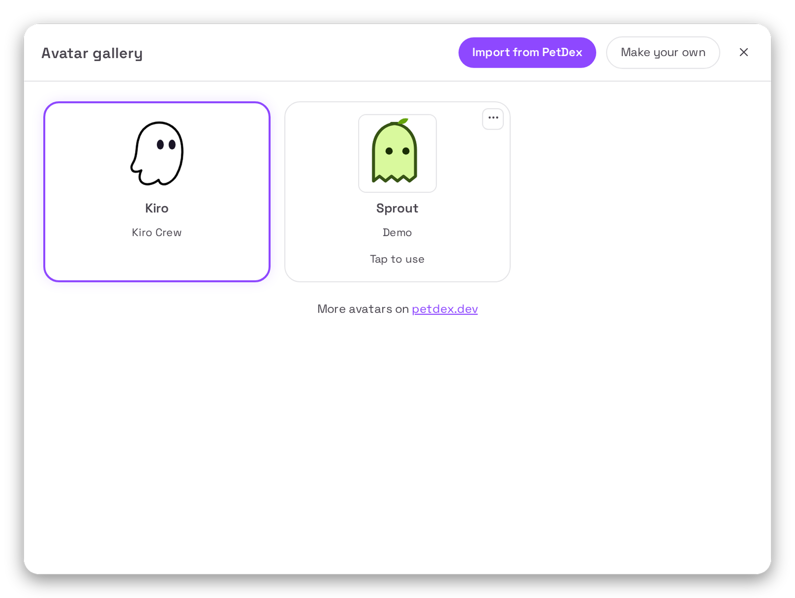
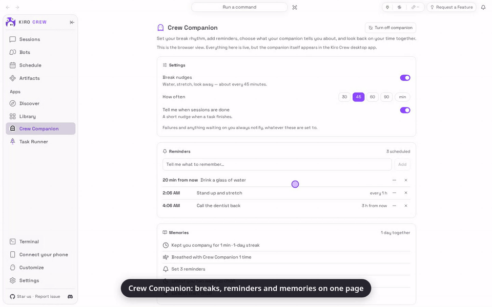

# Crew Companion

<picture>
  <source media="(prefers-color-scheme: dark)" srcset="docs/media/hero-dark.png">
  
</picture>

**A small companion on your desktop that keeps you on a healthy rhythm while Kiro Crew works.**

Crew Companion is an app for [Kiro Crew](https://github.com/kirodotdev/KiroCrew),
the open-source personal AI agent.

## What it is

Crew Companion puts a small ghost on your desktop when you use the Kiro Crew
desktop app. It nudges you to drink water, stretch or look away on a rhythm you
choose, holds the reminders you write in plain words ("drink water in 20
minutes"), runs a short breathing exercise, and speaks up when a Kiro Crew
session finishes, fails, or waits for your OK. A **Crew Companion** page in Kiro
Crew holds the same settings, your reminders and a look back at your time together.



**Get started:** open **Apps → Library**, open the **⋯** menu on **Crew
Companion** and choose **Enable**. [Install](#install) has the details.

## The problem it solves

When an agent is doing the work, it is easy to sit still for hours, forget the
glass of water and miss the moment a long task needs you. Phone alarms are
loud, and checking the dashboard every few minutes breaks your focus.

Crew Companion sits quietly at the edge of your screen. A break nudge fades by
itself if you ignore it, a reminder you set waits until you see it, and a
session that needs your OK gets a bubble with a button that takes you straight
there. It does not nudge you while you are away from the computer.

## Top 3 use cases

### 1. Keep a break rhythm

You work in long stretches and want a gentle push every 45 minutes. On the
**Crew Companion** page, switch on **Break nudges** and pick **30**, **45**,
**60**, **90** or your own number of minutes. The companion then suggests water,
a stretch or a look out of the window, and now and then a short breathing
exercise.



### 2. Write reminders the way you would say them

You remember you must call the dentist back this afternoon. Click the companion
to open its panel, or use the **Reminders** box on the page, and type "call the
dentist back at 4pm" or "stand up every hour". The panel's **Up next** list shows
what is coming and when.



### 3. Give it a look you like

You would rather have a different companion. Right-click it and choose **Change
avatar** to open the gallery: pick another avatar, recolour one, draw your own
with **Make your own**, or bring one in with **Import from PetDex**.



## Watch it



[Watch the walkthrough as a video (MP4)](docs/media/walkthrough.mp4).

<sub>Recorded from a real Kiro Crew (see `docs/media/media.json` for the commits)
on a throwaway home with made-up demo data. No AI model is involved: everything
shown is the app's own page. The desktop pictures above are the app's own window
pages in a browser, with the desktop app's window bridge played by the capture
script; the desktop app itself was not running.</sub>

## Install

**If you already have Crew Companion.** It used to come built into Kiro Crew.
The Kiro Crew release that moves it to this repository does so by itself: your
reminders, settings, avatars and saved position stay, and it stays switched on
or off as it was. There is nothing to do.

**From the Kiro Crew App Store**

1. In Kiro Crew, open **Apps → Discover** in the left sidebar.
2. Search for **Crew Companion** and choose **Install**.
3. Kiro Crew asks **Trust “Crew Companion” to run its own code?** Crew
   Companion runs a small program of its own inside Kiro Crew that keeps your
   reminders and decides when a nudge is due. Trusting it gives that program the
   same access Kiro Crew has (your files, your saved sign-ins and the internet),
   as the dialog says. If you are happy with that, choose **Trust this app**. You
   can take it back later in **Settings → Security → Third-party apps**.
4. The app installs switched off. Choose **Enable** on its page. It then shows
   up under **Apps** in the sidebar and in **Apps → Library**.

What you need: the Kiro Crew desktop app on a Mac, Linux or Windows computer for
the companion itself. In a browser you get the page, with the same settings,
reminders and memories, but no companion on the screen. No accounts or keys.

## First run

Once it is on, the companion appears near the bottom right of your screen, and
the **Crew Companion** page says **Nothing scheduled yet** under **Reminders**.
Drag the companion wherever you like: it remembers the spot, and on several
screens it moves to the screen you drag it to. Click it once to see its panel.

## How to use it

1. **Click** the companion to open its panel: **Up next** lists your reminders,
   **Let's breathe →** starts the breathing exercise, and **Settings** changes
   the break rhythm and session alerts.
2. **Type a reminder** in the panel's box (or the page's **Reminders** box), for
   example "drink water in 20 minutes", and press Enter. A reminder without a time
   asks you for one.
3. When a **bubble** appears, read it: a break nudge leaves by itself, a reminder
   stays until you dismiss it, and **Open session** on a session alert takes you to
   that session in Kiro Crew.
4. **Right-click** the companion for **Change avatar** and **Turn off companion**.
5. On the page, the **⋯** next to a reminder offers **Skip just the next one** (for a repeating one),
   **Edit** and **Change schedule**; **×** removes it.

## Settings & data

- **Where your data lives:** `~/.kiro/crew/apps/crew-companion/data/` (or under
  `$KIROCREW_HOME` if you set it): your reminders and settings in
  `crew-companion-reminders.json`, your avatars in `appearances/`.
- **What leaves your computer:** nothing, unless you use **Import from PetDex**,
  which looks the pet up on petdex.dev and downloads its art from there. The
  **petdex.dev** link opens in your browser.
- **Turn it off:** **Turn off companion** on the companion's menu or at the top
  of its page, or **Apps → Library**, the **⋯** menu on Crew Companion,
  **Disable**. Your data is kept.
- **Remove it:** the same menu, **Uninstall**. **Keep app data** is ticked by
  default; untick it to delete the data too.

## Troubleshooting / FAQ

**I enabled it but see no companion on my screen.**
The companion lives in the Kiro Crew desktop app. In a browser you only get the
page, which says **This is the browser view**. Open the desktop app and it
appears within a few seconds.

**I added a reminder and the box says “Tell me when, too”.**
The reminder needs a time. Add one the way you would say it, for example
"in 20 minutes", "at 4pm" or "every hour".

**I get no break nudges.**
Check that **Break nudges** is on. Nudges also pause while you are away from the
computer and start again when you are back. A reminder you set still arrives.

**I want to know when a task is done, but not every time.**
Switch off **Tell me when sessions are done**. Failures and anything waiting for
your OK still notify you.

**The panel says “This screen didn't load.”**
Kiro Crew could not be reached for a moment. Close the panel and open it again.

## Development

This repository is the externally packaged form of the `crew-companion` app that
shipped built into Kiro Crew. The two share a name, a version and the same
permissions, so a Kiro Crew release that pins this repository moves an existing
built-in install onto it in place: reminders, settings and avatars stay where
they are. Until a user's Kiro Crew does that, it keeps running its built-in copy.
[PORTING.md](PORTING.md) lists every place this copy differs from the built-in
and why.

| Path | What it is |
|---|---|
| `app.json` | The manifest: the page, the four desktop windows (`desktop.windows`), the hooks and the `l10n` listing copy |
| `backend/routes.py` | The in-gateway routes (`backend.hooks.routes`); every write is owner-only |
| `backend/store.py`, `backend/reminders.py` | The reminder store, the break rotation and the tick that decides what fires |
| `backend/hooks.py`, `backend/runtime.py` | Start and stop with the app; the process-wide runtime the routes read |
| `backend/_host.py` | The only module that touches the gateway |
| `ui/src/entries/` | The page (`index`) and the desktop windows (`pet`, `notifier`, `panel`, `gallery`) |
| `ui/src/desktop/` | The companion's bridge between its windows, over the desktop shell's window bridge |
| `ui/src/host/` | Dashboard helpers the App Kit SDK does not export, copied from Kiro Crew |
| `ui/i18n/` | The strings in every language the dashboard ships |
| `ui/dist/` | The built page and windows, **committed**: an install is a plain clone with no build step |
| `ui/tests/`, `tests/` | UI tests (vitest + happy-dom) and backend and manifest tests (pytest), all offline |
| `assets/` | Store icon, hero art and screenshot |
| `capture/` | Captures the README media from a real, isolated Kiro Crew ([capture/README.md](capture/README.md)) |
| `docs/media/` | The README pictures and walkthrough, plus `media.json` |

### What it needs from Kiro Crew

App Kit seam level 7 for the desktop windows: an overlay on every display
(`displays: "all"`), a `background` window and a panel `gutter`, and bridge
level 2 in the desktop app (messages between the app's windows, the drag across
displays, `showSession`, `openExternal`). A gateway older than that refuses the
manifest; an adoption pin of this app carries `minAppSdkLevel` 7. The backend
uses the owner gate (`ctx.require_owner`) and the event bus (`ctx.events`), and
the gateway's own avatar library, looked up by name in `backend/_host.py`.

### Install from a clone

```bash
git clone https://github.com/KiroCrewCaptain/kirocrew-app-crew-companion
kirocrew app install ./kirocrew-app-crew-companion
```

Then turn it on from **Apps → Library**. The app runs its own code
(`backend.hooks` in `app.json`), so Kiro Crew will not enable it until you trust
it: the Library's **Enable** opens **Trust “Crew Companion” to run its own
code?**, and **Trust this app and enable** does both. Until it is trusted,
`kirocrew app enable crew-companion` is refused with `app_execution_denied`;
there is no command-line trust step.

While your Kiro Crew still has the built-in copy installed, the install itself
is refused: `app 'crew-companion' is already installed`.
`kirocrew app disable crew-companion` turns the app off, and
`kirocrew app uninstall crew-companion` (add `--purge-data` to delete the data)
removes an installed copy.

### Tests

```bash
python -m pip install -r tests/requirements.txt
python -m pytest
cd ui && npm ci && npm run typecheck && npm test && npm run build
```

`npm run build` rewrites `ui/dist/`; CI fails when the committed bundles differ
from what the source builds.

### Re-capture the README media

The pictures and the recording come from a real, isolated Kiro Crew gateway
driven by [`capture/`](capture/README.md). The gateway's checkout must not ship
the built-in Crew Companion (remove `src/kiro_crew/apps/builtins/crew_companion/`
and its `BUILTIN_NAMES` row in a throwaway checkout), because the setup installs
this repository under the same name. After any change to what the app shows:

```bash
python capture/capture.py --kirocrew /path/to/KiroCrew
python capture/check_readme.py
```

Then look at every image and at a few frames of the video before committing
(see [CHECKLIST.md](CHECKLIST.md)).

## License

Apache License 2.0. See [LICENSE](LICENSE), [NOTICE](NOTICE) and
[THIRD-PARTY-NOTICES](THIRD-PARTY-NOTICES).
